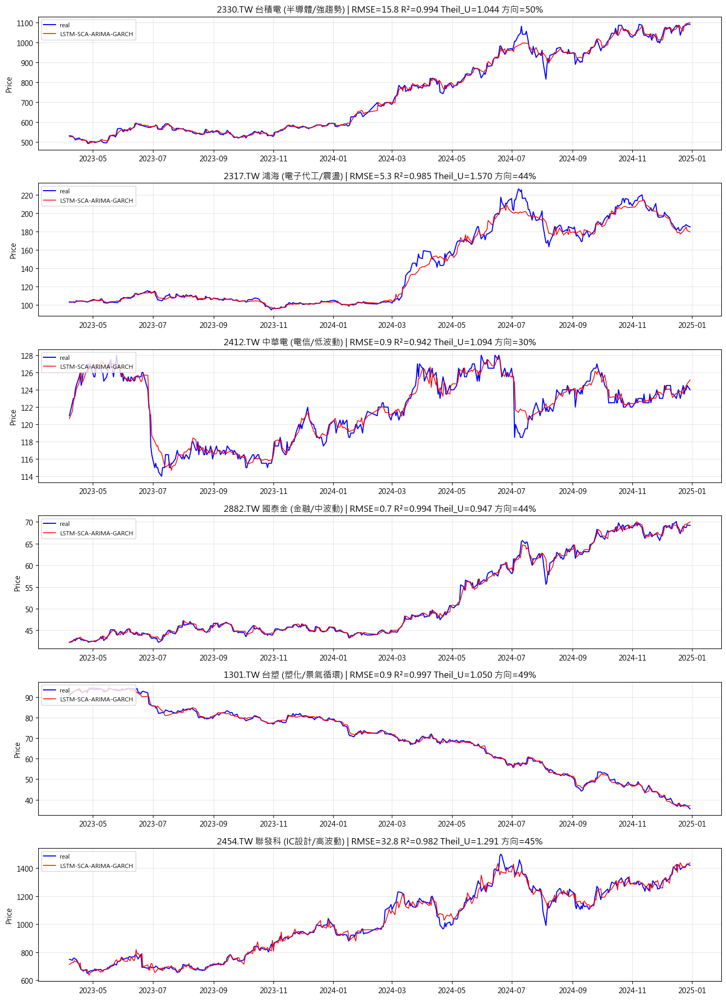
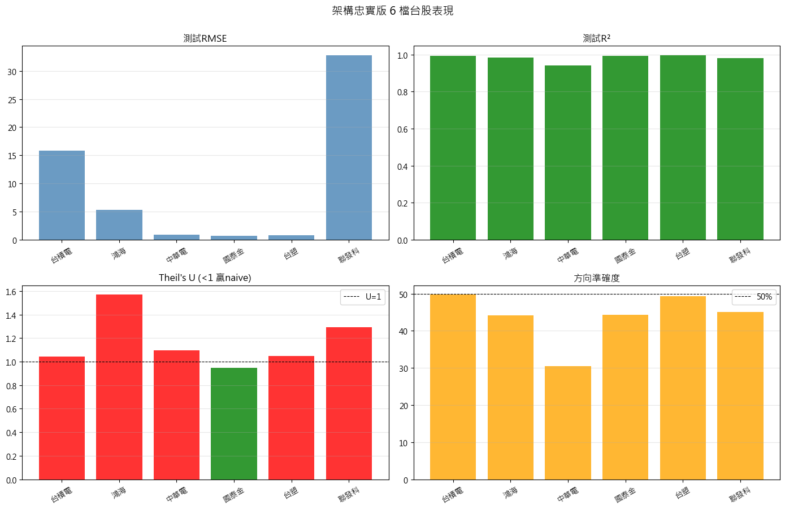
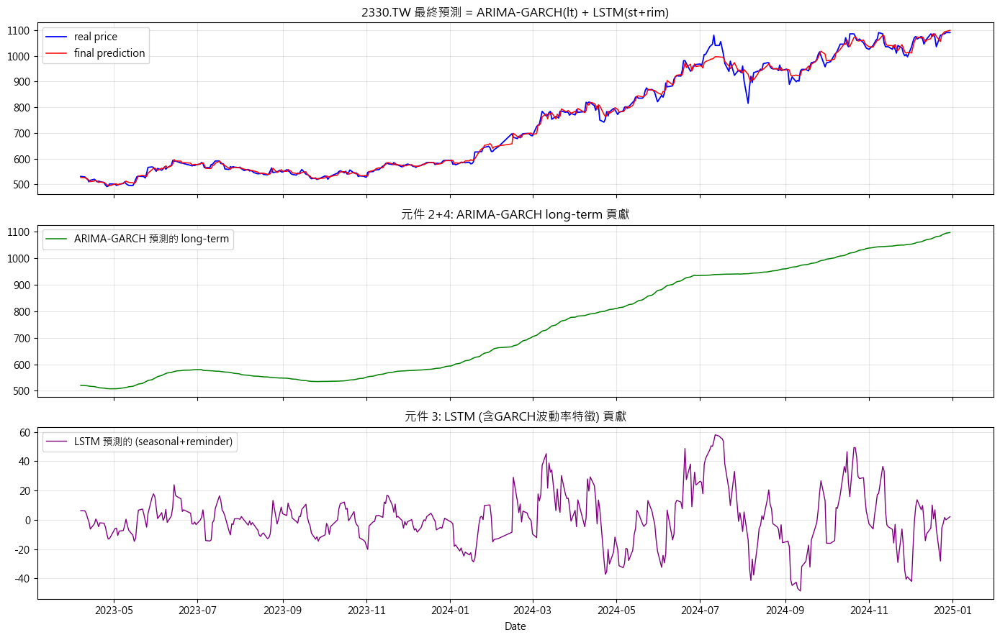

# LSTM-SCA-ARIMA-GARCH 台股預測：一次關於評估指標的實證檢驗

> 完整複現 2025 年發表於 *The Journal of Supercomputing* 的混合預測架構，套用於 6 檔台股（2018–2024），
> 並用 Theil's U 與方向準確率檢驗「測試集 R² = 0.98」到底代表什麼。
>
> **結論：不代表模型有用。**



---

## TL;DR

| 觀察 | 數字 |
|---|---|
| 平均測試集 R² | **0.9823** — 看起來非常成功 |
| 平均 Theil's U | **1.1658** — 6 檔中有 5 檔 > 1，即**劣於「明天 = 今天」的 naive 基準** |
| 平均方向準確率 | **43.83%** — 低於丟硬幣的 50% |

三個數字來自同一組預測。**如果只報告 R²，這會是一個成功的專案；加上另外兩個指標，它是一個失敗的預測器。**
這個落差就是本專案想要說明的事。

---

## 為什麼 R² 0.98 是假象

單步預測任務中，t 日的真實價格與 t−1 日高度相關。模型只要學會「輸出接近前一日收盤價」，
R² 就會自動逼近 1——它擬合的是價格序列本身的慣性，不是任何預測訊號。

上圖放大任何一段都能看到：紅線（預測）幾乎是藍線（實際）**向右平移一格**的結果。

要拆穿這件事，需要一個把 naive 基準放進分母的指標：

```
Theil's U = RMSE(模型) / RMSE(前一日收盤價作為預測)

    U < 1   模型優於 naive
    U = 1   與 naive 等效
    U > 1   劣於 naive —— 即使 R² = 0.99
```

本專案 6 檔標的中只有國泰金（U = 0.947）勉強低於 1，其餘 5 檔全部大於 1。
方向準確率同樣全數低於 50%，其中中華電僅 30.4%。

**這不是實作有 bug，而是這個任務設定本身難以產生交易價值。** 誠實報告它，比調參數把 R² 推到 0.99 更有意義。

---

## 完整結果

| 股票 | 名稱 | 測試 RMSE | 測試 R² | Theil's U | 方向準確率 | SCA 選出的 hidden | p | q |
|---|---|---|---|---|---|---|---|---|
| 2330.TW | 台積電 | 15.83 | 0.9938 | 1.0435 | 49.76% | 16 | 1 | 1 |
| 2317.TW | 鴻海 | 5.32 | 0.9846 | 1.5697 | 44.10% | 20 | 1 | 1 |
| 2412.TW | 中華電 | 0.90 | 0.9416 | 1.0937 | 30.42% | 16 | 1 | 1 |
| 2882.TW | 國泰金 | 0.72 | 0.9942 | **0.9468** | 44.34% | 65 | 1 | 1 |
| 1301.TW | 台塑 | 0.86 | 0.9971 | 1.0501 | 49.29% | 50 | 2 | 3 |
| 2454.TW | 聯發科 | 32.79 | 0.9823 | 1.2910 | 45.05% | 31 | 3 | 1 |
| | **平均** | **9.40** | **0.9823** | **1.1658** | **43.83%** | | | |

資料期間 2018-01-01 至 2024-12-31，每檔 1,700 個交易日，依時序切分為訓練 1,275 日 / 測試 425 日（75 / 25）。
6 檔標的刻意涵蓋不同波動特性（強趨勢、震盪、低波動、景氣循環、高波動），以檢驗結論是否具一致性。



---

## 架構

論文提出的六個元件全部實作，未省略任何一項：

```
                       價格序列
                          │
                   ┌──────┴──────┐
                   │  ① STL 分解  │
                   └──────┬──────┘
         ┌────────────────┼────────────────┐
         ▼                ▼                ▼
    long-term         seasonal         reminder
         │                └───────┬────────┘
         ▼                        ▼
  ② ARIMA(p,0,q)            ③ 多特徵 LSTM
   預測趨勢變化量          輸入 [rim, st, vol]
         │                        ▲
         ▼                        │
  ④ GARCH(1,1) ──── 條件波動率 ───┘
   估計條件波動率
         │                        │
         └──────────┬─────────────┘
                    ▼
            ⑥ 重組：lt_pred + lstm_pred
                    ▲
         ⑤ SCA 聯合優化 6 維位置向量
      [hidden, epochs, lr, lr_factor, p, q]
```

| 元件 | 實作重點 |
|---|---|
| ① 分解 | STL（`robust=True`），週期 20 |
| ② ARIMA | 單步滾動，**預測趨勢的變化量再還原**（見下方決策紀錄） |
| ③ LSTM | 輸入 3 特徵 `[reminder, seasonal, garch_vol]`，目標為 `seasonal + reminder` |
| ④ GARCH | GARCH(1,1) 滾動一步前預測，輸出**作為 LSTM 的輸入特徵實際參與預測** |
| ⑤ SCA | 4 代理 × 5 迭代 = 24 次適應度評估／檔，每次評估含完整滾動預測 |
| ⑥ 重組 | `final = lt_pred + lstm_pred` |



### 防資料洩漏的處理

- ARIMA 與 GARCH 皆採 walk-forward，每次預測只使用該時點之前的觀測值
- `StandardScaler` 僅以訓練段擬合，再套用至全段
- Theil's U 的 naive 基準取「前一日真實收盤價」，與模型使用相同的可得資訊

---

## 工程決策紀錄

這個架構試了三個版本才定案，過程本身比最終數字更有參考價值：

| 版本 | 做法 | 結果 | 判定 |
|---|---|---|---|
| v1 | 完全照論文：多步靜態外推 | R² **全部為負** | 架構完整但不可用 |
| v2 | 拆掉分解與 GARCH，改純 LSTM + 差分 | R² 高 | 可用但已不是論文的模型 |
| **v3（本版）** | 保留完整架構，預測模式改單步滾動 | R² 高且架構完整 | 採用 |

**v1 失敗的原因**：台股在 2023–2024 出現劇烈結構性轉折（半導體大漲、傳產下行）。
在多步靜態外推下，ARIMA 對極度平滑的 STL 趨勢分量必然退化成一條水平線，誤差隨步數累積發散。

**唯一的修改是預測時序，不是模型結構。** 單步滾動是時間序列預測的標準實務作法，
六個元件與其連接方式完全保留。

另一個關鍵細節：ARIMA 若直接對趨勢**水準值**外推同樣會輸給 naive，改為預測**一階差分**再還原
（`lt_pred[t] = lt_real[t-1] + forecast(diff)[t]`）才能取得合理結果。

---

## 專案結構

```
.
├── src/
│   ├── config.py          # 標的、期間、SCA 搜尋空間
│   ├── data.py            # yfinance 下載與切分
│   ├── decomposition.py   # ① STL 分解
│   ├── arima_garch.py     # ② ARIMA 趨勢預測 ④ GARCH 波動率
│   ├── lstm_module.py     # ③ 多特徵 LSTM
│   ├── sca.py             # ⑤ 正弦餘弦最佳化
│   ├── metrics.py         # RMSE / R² / Theil's U / 方向準確率
│   ├── pipeline.py        # ⑥ 重組與單一標的完整流程
│   └── run_all.py         # CLI 入口
├── notebooks/
│   └── 01_full_pipeline.ipynb   # 原始實驗紀錄（含完整輸出與圖表）
├── results/summary.csv          # 論文中引用的結果
└── docs/                        # 圖表
```

---

## 如何執行

```bash
git clone https://github.com/yc1628/lstm-sca-arima-garch-tw.git
cd lstm-sca-arima-garch-tw

python -m venv .venv && source .venv/bin/activate   # Windows: .venv\Scripts\activate
pip install -r requirements.txt

# 快速確認流程可跑（單一標的、縮小 SCA 預算，約 2–3 分鐘）
python -m src.run_all --tickers 2330.TW --size 2 --max-it 2

# 完整重現 README 的結果（6 檔，CPU 約 100 分鐘）
python -m src.run_all
```

結果會寫入 `results/`：`summary.csv` 為彙總表，`pred_<ticker>.csv` 為逐日預測明細。

實測執行時間（Python 3.12 / CPU）：單檔 757–1,542 秒，6 檔合計約 107 分鐘。
瓶頸在 SCA——每次適應度評估都要完整跑一遍 ARIMA + GARCH + LSTM 滾動預測。

---

## 已知限制

- **僅使用收盤價單一序列**，未納入成交量、技術指標或總經變數
- **SCA 預算偏小**（4 代理 × 5 迭代）。從日誌可見多檔標的的 `best_fit` 在第 2 至 3 次迭代後即不再改善，
  無法排除是「已收斂」或「搜尋預算不足」，需擴大預算並跑多次隨機種子才能判定
- **未做多種子重複實驗**，故無法區分指標差異是真實效果或隨機波動
- **未計入交易成本**，也未進行任何回測；本專案只做預測，不構成任何投資建議
- 資料來源 `yfinance` 為非官方 API，可能因未調整之公司行動（除權息、減資）而與實際價格有出入

---

## 可延伸方向

- 加入 GARCH 特徵的 on/off 消融實驗，量化元件 ④ 的邊際貢獻
- 將預測目標從價格改為報酬率，直接對齊方向準確率這個真正重要的指標
- 加入技術指標（RSI、MACD）作為 LSTM 額外輸入
- 以多隨機種子建立雜訊門檻，再判定各元件的效果是否顯著

---

## 參考文獻

Mehtarizadeh et al. (2025). *Stock price prediction with SCA-LSTM network and Statistical model ARIMA-GARCH.*
The Journal of Supercomputing, 81:366.

---

## 授權

MIT License — 詳見 [LICENSE](LICENSE)。
